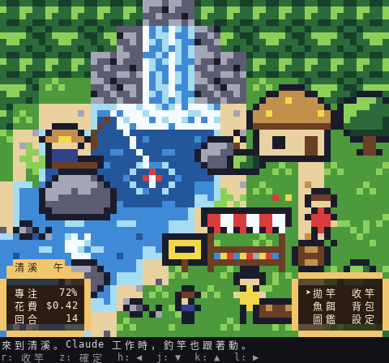
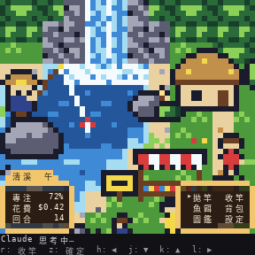
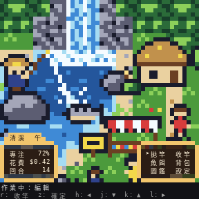
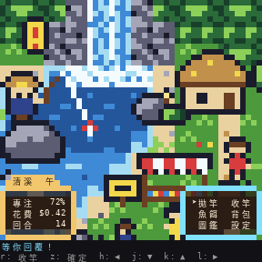
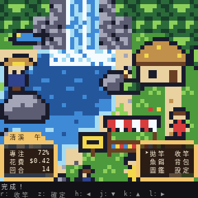
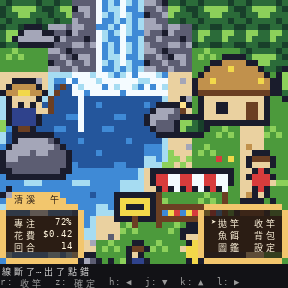
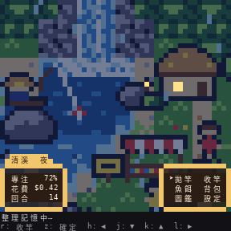

# claude-for-fun

**繁體中文** · [English](README.en.md)

> 在 Claude Code 旁邊釣魚：一個**經典 16-bit 像素風 RPG** 的窗格，跟著 Claude 的工作狀態一起動。



`fishing` 是一個 Claude Code mod（hooks 模組外掛）。它在對話右側開一個窗格，畫一幅會動的像素畫：俯視角的溪流、瀑布、茅草屋與市集小攤，還有一位坐在岩石上的釣客。Claude 開始思考時他拋竿，用工具時魚上鉤掙扎，等你回覆時頭上冒出「！」，完成時把魚高高舉起。

## 特色

- **會動的場景**：流水與白浪、瀑布、搖曳的草、浮標與釣線、閒晃的村民，以及依本地時間變化的晨、午、暮、夜色調。
- **跟著 session 狀態**：思考、使用工具（依讀取、編輯、指令、網路、分身各有不同的魚和水花）、等你回覆、完成、出錯、整理記憶，各有自己的動畫，見下方[對照表](#狀態對照表)。
- **HUD 綁定真實數字**：狀態視窗顯示 context 剩餘（專注）、花費、回合數；也可以改成工具次數、週額度、5 小時額度或漁獲。
- **原創音效**：拋竿、咬鉤、上鉤、斷線、等待提示、完成的小樂句，全部由程式合成。預設關閉，`/fishing sound on` 開啟。
- **可換主題**：場景、HUD 文字、顏色、動畫和音效都是資料（`theme.json`＋精靈圖文字檔＋地圖），不必改程式碼。內建 `river-rpg`（清溪），也可以照[做你自己的主題](#做你自己的主題)的步驟做出你的主題。
- **三種語言**：繁體中文、日本語、English。

## 狀態對照表

| 狀態 | 什麼時候 | 畫面 | 音效 | HUD |
| --- | --- | --- | --- | --- |
| `idle` 靜候 | 沒有回合在跑 | 釣客坐著，浮標漂著；偶爾自己咬鉤（按 `r` 收竿） | 咬鉤 `bite`、上鉤 `catch` | 訊息列顯示釣魚小遊戲 |
| `thinking` 思考 | 回合開始、工具做完之後 | 拋竿，浮標順著水流飄 | 拋竿 `cast` | 「Claude 思考中…」 |
| `tool` 作業 | 工具執行中 | 魚上鉤掙扎：讀取＝香魚＋漣漪、編輯＝山女鱒＋水花、指令＝岩魚＋水花、網路＝鯉魚、分身＝大傢伙 | 咬鉤 `bite`（連續呼叫會合併） | 「作業中：編輯」 |
| `waiting` 等你 | 權限確認、Claude 問你問題 | 釣客頭上閃著「！」 | 等待提示 `waiting` | 指令視窗邊框閃爍、游標閃爍 |
| `done` 完成 | 回合正常結束（約 3 秒） | 水花、收線、把魚舉起來 | 完成 `done` | 「完成！」，漁獲 +1 |
| `error` 出錯 | 工具失敗、回合中斷或錯誤 | 釣線斷掉，頭上一朵小烏雲 | 斷線 `snap` | 「線斷了…」 |
| `compacting` 整理記憶 | `/compact` 或自動壓縮 | 天黑、下雨 | — | 「整理記憶中…」 |

| 思考 | 作業 | 等你 |
| --- | --- | --- |
|  |  |  |
| **完成** | **出錯** | **整理記憶** |
|  |  |  |

## 安裝

在 Claude Code 終端機的輸入框輸入：

```
/plugin install fishing --marketplace osisdie/claude-for-fun
```

接著按 `y` 加入這個 marketplace，再選 user scope（Enter）。

從 shell 安裝：

```bash
claude plugin install fishing --marketplace osisdie/claude-for-fun
```

- **私有 fork**：安裝時不會詢問帳密，要先讓 git 能讀到 GitHub：`gh auth login`，再 `gh auth setup-git`（或設定 SSH 金鑰）。
- **從本機 clone 安裝**：

  ```bash
  git clone https://github.com/osisdie/claude-for-fun.git ~/projects/claude-for-fun
  claude plugin marketplace add ~/projects/claude-for-fun
  claude plugin install fishing@claude-for-fun
  ```

  從資料夾加入的 marketplace 會直接讀那個資料夾：改了檔案後，在 Claude Code 裡執行 `/reload-plugins` 即可。
- **更新**：`claude plugin update fishing`，然後在 Claude Code 裡 `/reload-plugins`。
- **開發中直接執行**（不安裝）：

  ```bash
  claude --plugin-dir ~/projects/claude-for-fun/plugins/fishing
  # 或
  export CLAUDE_CODE_PLUGIN_DIRS=~/projects/claude-for-fun/plugins/fishing
  ```

  `CLAUDE_CODE_PLUGIN_DIRS` 也可以寫在 `~/.claude/settings.json` 的 `"env"` 區塊。這兩種方式下，存檔就會自動重新載入。

### 打開窗格

- 窗格要在**全螢幕版面**才會停靠在對話右側（終端機 110 欄以上）：輸入 `/tui fullscreen`，或只這次啟動加 `CLAUDE_CODE_NO_FLICKER=1`。一般版面下它會出現在輸入框上方，是一條較矮的地圖。
- 終端機寬 144 欄以上會自動開啟；較窄時輸入 `/fishing`。

## 平台說明

| | Windows ＋ WSL | macOS（尚未驗證） |
| --- | --- | --- |
| 終端機 | Windows Terminal。WSL 的 shell 常沒有 `COLORTERM`，這時 mod 會用主題指定的 256 色；想要 24-bit 就在 `~/.bashrc` 加 `export COLORTERM=truecolor`。 | 建議 iTerm2 或 Ghostty（真彩色）。Terminal.app 只有 256 色，`auto` 會自動用主題的 256 色版本。 |
| `▀` 寬度 | 若畫面歪斜（CJK 字型把 `▀` 畫成兩格寬）：`/fishing pixel full`，或選含方塊字元的等寬字型（如 Cascadia Mono）。 | 少見；同樣可用 `/fishing pixel full`。 |
| 音效 | `auto`：Windows 11 的 WSLg 用 `paplay`（透過 PulseAudio，最快）；沒有 WSLg 時用 `powershell.exe`（Windows 的 SoundPlayer，每次約 0.6 秒啟動延遲）。`/fishing sound test` 試聽。 | `afplay`（系統內建）。 |
| 窗格寬度 | 右側停靠需全螢幕版面且 ≥110 欄；≥144 欄自動開啟；否則 `/fishing`。 | 同左。 |

## 使用

### 按鍵

先用 `ctrl+x tab`（或點一下窗格）把鍵盤交給窗格，`Esc` 回到輸入框。

| 按鍵 | 作用 |
| --- | --- |
| `r` | 收竿：咬鉤時按下必定釣到（而且魚比較大） |
| `z` | 執行 ➤ 指著的指令 |
| `h` `j` `k` `l` | 移動 ➤（左、下、上、右） |
| `Tab`／方向鍵、`Enter` | 在按鈕間移動（➤ 會跟著）、按下 |

指令視窗：**拋竿**（重新拋）、**收竿**、**魚餌**（換餌，咬鉤比較快）、**背包**（換竿，魚比較大）、**圖鑑**（看漁獲）、**設定**（目前主題與音效）。

### 指令

| 指令 | 作用 |
| --- | --- |
| `/fishing` | 開啟窗格（`/fishing close` 關閉） |
| `/fishing themes`、`/fishing theme <名稱>` | 列出／切換主題；壞掉的主題不會切換，並列出錯誤 |
| `/fishing locale <zh-TW\|ja\|en>` | 語言 |
| `/fishing stats <來源,…>` | 狀態視窗要顯示的 1–4 個數字（見下表） |
| `/fishing sound on\|off\|alerts\|all` | 音效開關；`alerts` 只播「等你」和「完成」 |
| `/fishing sound test [事件]` | 立刻試聽（`cast`、`bite`、`catch`、`snap`、`waiting`、`done`） |
| `/fishing sound player <名稱>`、`volume <0-1>`、`quiet <HH:MM-HH:MM\|off>` | 播放器、音量、勿擾時段 |
| `/fishing fps <2-8>`、`pixel <half\|full>`、`color <auto\|truecolor\|256>` | 速度、像素模式、色彩模式 |
| `/fishing reload`、`/fishing status` | 重新讀檔；顯示目前狀態、播放器與路徑 |

### 狀態視窗的數字

| 來源 | 內容 | 預設標籤（zh-TW） |
| --- | --- | --- |
| `contextLeft` | context window 剩餘 % | 專注 |
| `cost` | 這個 session 的花費（美元） | 花費 |
| `turns` | 這個 session 的回合數 | 回合 |
| `tools` | 工具呼叫次數 | 工具 |
| `weeklyLeft`、`fiveHourLeft` | 週／5 小時用量額度剩餘 % | 週額度、時額度 |
| `catches` | 累計漁獲 | 漁獲 |

數字來自 `$.session.usage()` 和 `session.measure`；主機沒有回報的值顯示為 `--`。標籤可在主題或 profile 的 `overrides.labels.<語系>.stats` 改。

### Profile

`~/.claude/fishing/profile.json`（不存在就全部預設）。上面的指令都會寫進這個檔案，並保留其他欄位。範例：[`plugins/fishing/profile.example.json`](plugins/fishing/profile.example.json)。

| 欄位 | 預設 | 說明 |
| --- | --- | --- |
| `theme` | `"river-rpg"` | 主題資料夾名稱 |
| `locale` | `"zh-TW"` | `zh-TW`、`ja`、`en` |
| `stats` | `["contextLeft","cost","turns"]` | 狀態視窗的數字 |
| `sound.enabled` | `false` | 音效開關 |
| `sound.player` | `"auto"` | `auto`、`afplay`、`paplay`、`aplay`、`powershell`、`engine`、`none` |
| `sound.volume` | `0.6` | 0–1（`aplay` 與 `powershell` 沒有音量控制） |
| `sound.quietHours` | `""` | 例如 `"22:00-07:00"` |
| `sound.mute` | `[]` | 不播的事件，例如 `["bite"]` |
| `sound.alertsOnly` | `false` | 只播 `waiting` 和 `done` |
| `sound.minGapMs` | `1500` | 同一事件兩次之間至少隔多久（防止連發） |
| `fps` | `6` | 活動時每秒幾格（2–8） |
| `pixelMode` | `"half"` | `half` 用 `▀` 每格 2 像素；`full` 每格 1 像素、不用 `▀` |
| `colorMode` | `"auto"` | `auto` 看 `COLORTERM`；`truecolor`；`256` |
| `autoOpen` | `true` | session 開始時自動開窗格（寬終端機） |
| `idleSlowMinutes`、`idleFreezeMinutes` | `5`、`15` | 閒置多久降到每秒 1 格、停止重畫 |
| `utcOffset` | `""` | 例如 `"+08:00"`；空字串用系統時區 |
| `overrides.palette`／`window`／`labels` | `{}` | 覆寫主題的顏色、視窗樣式、任何標籤 |

## 做你自己的主題

主題是一個資料夾。放在 `~/.claude/fishing/themes/<名稱>/`（你自己的，優先讀取）或 `plugins/fishing/themes/<名稱>/`（隨 repo 附帶）。

```
my-theme/
├─ theme.json        調色盤、地圖材質、物件、釣客、魚、狀態、音效、視窗、三語標籤
├─ map.txt           地圖：一個字元一格
├─ sprites/*.txt     精靈圖：一個字元一個像素
└─ sounds/*.wav      音效（選用）
```

**實例：做一個秋天版的清溪**

1. 複製：`mkdir -p ~/.claude/fishing/themes && cp -r ~/projects/claude-for-fun/plugins/fishing/themes/river-rpg ~/.claude/fishing/themes/autumn`
2. 改調色盤（`theme.json` 的 `palette`）。每個鍵是一個字元；`c256` 是沒有真彩色時用的 xterm-256 色號，`ascii` 只給文字預覽用：

   ```json
   "g": { "hex": "#b8742c", "c256": 136, "ascii": "\"" },
   "G": { "hex": "#e0a84a", "c256": 179, "ascii": "'" },
   "f": { "hex": "#8c3b1e", "c256": 88,  "ascii": "t" }
   ```

3. 畫精靈圖（`sprites/scenery.txt`）。`.` 是透明，`---` 分隔影格：

   ```text
   [tree_autumn]
   ..kkk..
   .kGGgk.
   kGggffk
   .kfffk.
   ..kbk..
   ---
   ..kkk..
   .kGgGk.
   kgGgffk
   .kfffk.
   ..kbk..
   ```

   放進 `objects`：`{ "sprite": "tree_autumn", "x": 30, "y": 44, "layer": "objects", "anim": { "kind": "loop", "speed": 8 } }`
4. 調整狀態的樣子（`states`）。例如整理記憶時下雨、讀檔時換一種魚：

   ```json
   "states": {
     "compacting": { "pose": "sit", "phase": "night", "rain": "c" },
     "tool": { "pose": "pull", "kinds": { "read": { "fish": "fish_koi", "effect": "ripple" } } }
   }
   ```

5. 換音效：把自己的 `.wav` 放進 `sounds/`，在 `"sounds"` 指定（`cast`、`bite`、`catch`、`snap`、`waiting`、`done`），或改 `tools/synth.py` 重新合成。
6. 改標籤：`labels.zh-TW.location` 改成 `"楓之溪"` 等。
7. 檢查並預覽（需要 [Bun](https://bun.sh)）：

   ```bash
   cd ~/projects/claude-for-fun
   bun tools/preview.ts --check --dir ~/.claude/fishing/themes
   bun tools/preview.ts autumn --dir ~/.claude/fishing/themes --session waiting
   bun tools/preview.ts autumn --dir ~/.claude/fishing/themes --shot autumn.png --phase evening
   ```

8. 在 Claude Code 裡輸入 `/fishing theme autumn`。

主題載入時會檢查。有錯時 `/fishing theme` 不會切換，並列出前幾個錯誤（檔名、行號、欄位）；若 profile 指定的主題之後壞掉，會改用預設主題，並在對話中留一行說明原因。

### `theme.json` 欄位

| 欄位 | 說明 |
| --- | --- |
| `schema` | 固定 `1` |
| `palette` | `{ 鍵: "#rrggbb" }` 或 `{ 鍵: { hex, c256?, ascii? } }`，建議 16 色左右 |
| `glow` | 夜裡不變暗的調色盤鍵（亮著的窗、燈） |
| `tileSize`、`map`、`outside` | 地圖一格幾像素、地圖檔、地圖外用哪個字元 |
| `sprites` | 精靈圖檔清單 |
| `tiles` | 地圖字元 → 材質：`sprite`、`anim`（`static`、`flow`＋`dir`、`loop`、`sparkle`）、`speed`、`edge`（岸線） |
| `speeds` | 具名速度（每多少個動畫刻度動一次；一秒 6 刻度） |
| `layers`、`objects` | 圖層順序；物件 `{ sprite, x, y, layer, anim?, night?, when?, flip?, offset? }`，`anim.kind`：`static`、`loop`、`patrol`、`swim`、`rise` |
| `angler` | 釣客：`sprite`（`null` 表示畫面上沒有人）、`poses`（姿勢名 → 影格）、`x`、`y`、`layer`、`rodTip`、`bobber`、`line`、`bobberSprite`、`rippleSprite?`、`splashSprite?` |
| `fish` | `{ id, sprite, value, weight, size: [最小, 最大] }` |
| `states` | 每個 session 狀態的樣子：`pose`、`alert`、`cloud`、`rain`、`phase`、`kinds`（工具類別 → `{ fish, effect? }`） |
| `sounds` | 事件 → `.wav`（相對於主題資料夾） |
| `focus`、`biteEverySeconds` | 畫面要保持可見的點；閒置小遊戲的咬鉤間隔 |
| `phases` | `morning`、`day`、`evening`、`night` 的色調 `{ tint, amount }` |
| `window` | HUD：`bg`、`border`、`text`、`accent`、`dim`、`opacity`、`tab`、`tabText`、`corners`（`round`／`square`） |
| `labels` | `zh-TW`、`ja`、`en` 各一份：`location`、`phases`、`stats`、`menu`、`controls`、`messages`、`states`、`tools`、`fish`、`baits`、`rods` |

## 音效與 WSL

`$.audio.play` 在 macOS 用 `afplay`，在 Linux 和 Windows 終端機上不會出聲。所以這個 mod **自己呼叫播放程式**（`$.process.run`），不去攔截 `audio.play` 事件。這樣每個平台的行為一致，音量也能控制。`engine` 選項保留 `$.audio.play`，給它本身就會出聲的主機用。

- **WSLg（Windows 11）**：`PULSE_SERVER` 已設定，`auto` 選 `paplay`。沒聲音時，確認 Windows 端有輸出裝置，並在 WSL 裡執行 `paplay /usr/share/sounds/...`（或任一 wav）試試。
- **沒有 WSLg**：`auto` 選 `powershell.exe`，用 `wslpath -w` 把檔案轉成 `\\wsl.localhost\...` 路徑交給 Windows 的 SoundPlayer。每次播放約有 0.6 秒的啟動延遲，也沒有音量控制。
- **純 Linux**：`paplay`，沒有的話用 `aplay`。
- 連續的工具呼叫會合併：同一事件至少間隔 `minGapMs`，任兩個音效至少間隔 0.4 秒（但「等你」和「完成」不會被吃掉）。

## 疑難排解

| 狀況 | 試試看 |
| --- | --- |
| 看不到窗格 | `/fishing`；右側停靠需要 `/tui fullscreen` 和 110 欄以上 |
| 畫面歪斜、條紋錯位 | `/fishing pixel full`，或換含方塊字元的字型 |
| 顏色很接近、看不清楚 | `export COLORTERM=truecolor`，或 `/fishing color 256` 用主題的 256 色 |
| 沒有聲音 | `/fishing status` 看播放器；`/fishing sound test`；`/fishing sound player powershell` |
| 主題沒套用 | `/fishing status` 會列出主題的錯誤；`bun tools/preview.ts --check --dir <資料夾>` |
| 數字顯示 `--` | 主機還沒回報（第一個回應之後才有），或不是訂閱帳號（沒有額度數字） |
| 太耗資源 | `/fishing fps 3`；閒置 5 分鐘後本來就會降速，15 分鐘後停止 |

## 開發

```bash
./tools/lay-types.sh                     # 把 API 型別放進 .claude-plugin/types/（git 忽略）
cd plugins/fishing
tsc -p .                                 # 型別檢查
claude plugin validate .                 # manifest 與 hooks 模組
claude plugin test .                     # mod 的測試
cd ../.. && claude plugin validate .     # marketplace
bun test tools/checks                    # 內建主題、原創性與 commit 訊息檢查
python3 tools/synth.py                   # 重新合成音效
tools/screenshots.sh                     # 重新產生 docs/screenshots/
```

## 原創與商標

這個專案的所有美術、音效與文字都是原創：精靈圖、地圖圖塊和版面都是從零手繪的像素畫，音效全部由 `tools/synth.py` 合成。風格是**經典 16-bit 像素風 RPG**。本專案與任何遊戲或公司都沒有關聯；提及的商標皆屬其各自的擁有者。

## 授權

MIT，見 [LICENSE](LICENSE)。
